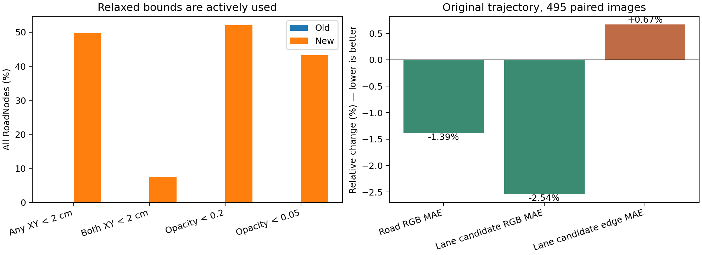
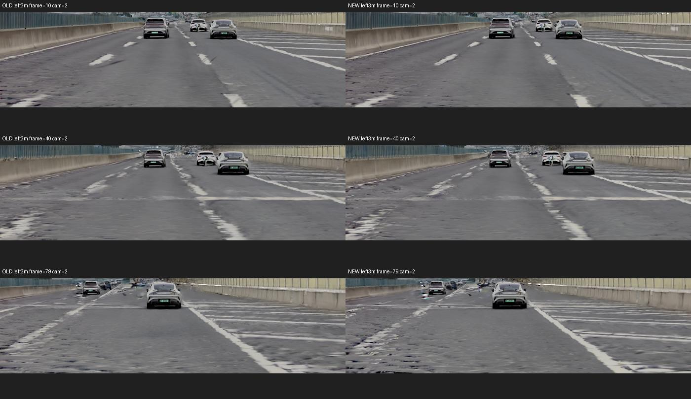
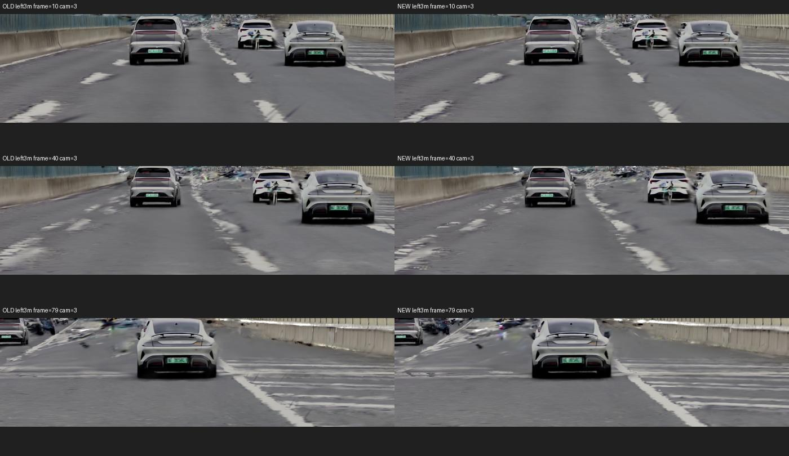
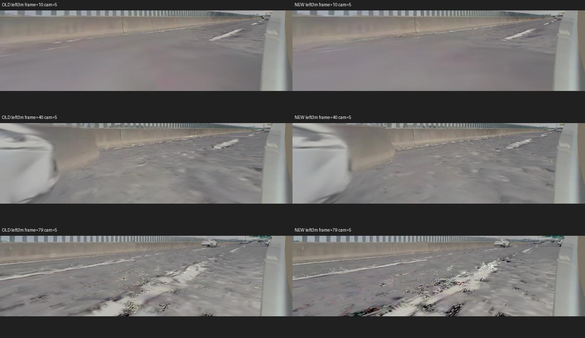
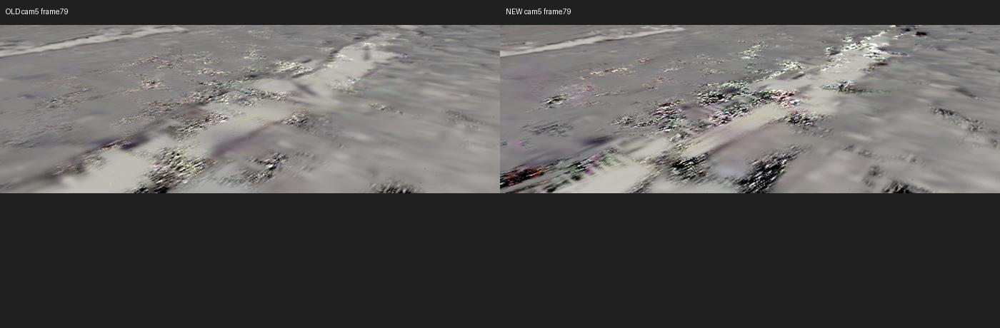
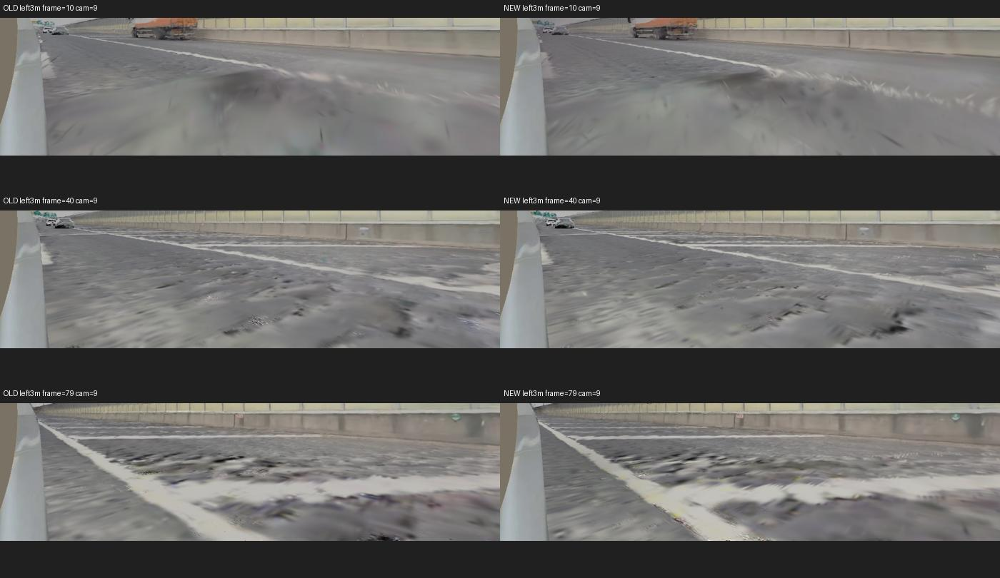
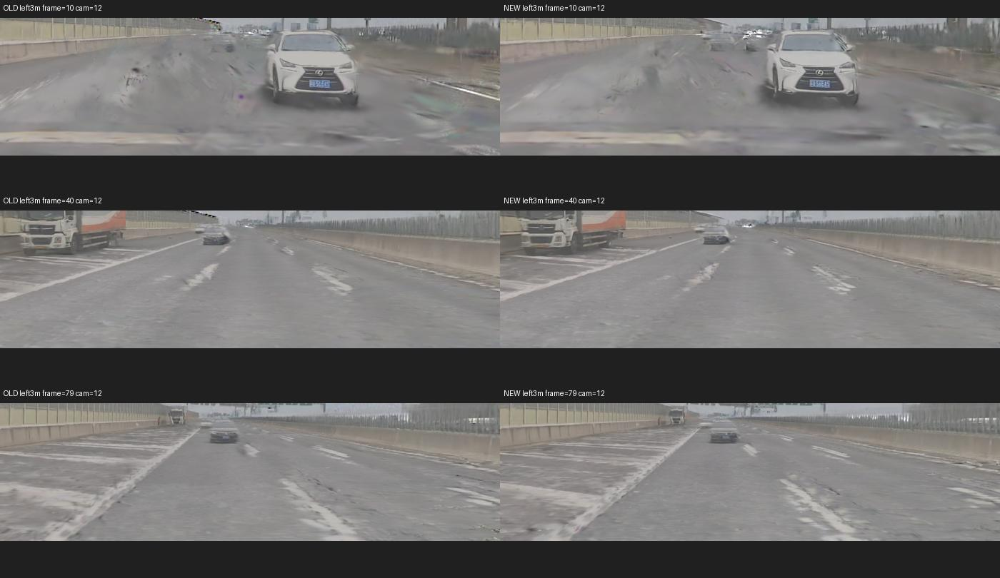

# Road adaptive scale / opacity 实验分析（2026-10-19）

结论：新版实际启用了更小的高斯和更低的 opacity，原视角的整体感知指标及路面/标线颜色误差小幅改善；但标线候选边缘误差没有改善，左移 3 m 的破碎边缘与黑斑仍明显，部分侧视区域更突出。因此本实验验证了参数自由度已生效，尚未验证“标线几何变好、黑洞减少”这一目标。

## 1. 比较口径与改动

- 旧版：`20261009_lidar+traincam2_3_5_9_12_0_1_6_7_10_11road-color-coverage`。
- 新版：`20261019_lidar+traincam2_3_5_9_12road-adaptive-s-o`。
- 只比较两者 group0，相机 2/3/5/9/12、99 帧、40000 步。旧版根目录的 11 相机 merged metrics 不参与比较。
- 配置实质差异：XY 下限 2→1 cm、硬 clamp→log 空间 sigmoid 有界映射；opacity 下限 0.2→0.01。上限 8 cm、初始物理尺度和 opacity、图像损失及覆盖/贡献损失权重保持一致。
- 路面中心、旋转及厚度冻结，没有启用路面分裂。group0 配置中的相机列表相同；仅运行 group0 不等于减少该组的训练相机。
- 两次独立初始化的 RoadNodes 数分别为 1,490,106 和 1,492,330，相差约 0.149%；各自训练首尾点数不变。不能把所有输出变化唯一归因于某一个下限，尺度参数化与 opacity 同时变化，且仅各跑一次。

## 2. 原视角结果

### 已保存的 group0 全集评估

| 指标 | 旧版 | 新版 | 变化 |
| --- | ---: | ---: | ---: |
| PSNR ↑ | 27.890969 | 28.002622 | +0.111653 |
| SSIM ↑ | 0.820795 | 0.821441 | +0.000646 |
| LPIPS ↓ | 0.265441 | 0.252975 | -0.012466 |

这些是训练所用原视角上的拟合指标，不是新轨迹泛化指标；LPIPS 改善约 4.70%，不能直接解释成标线几何改善。

### 对原轨迹逐帧导出图重新计算的局部误差

使用 495 对原轨迹 RGB 与 processed 真实 RGB；同一套 road mask，排除可用的 dynamic/ego/sky mask，向内腐蚀 3 px。标线候选使用与现有策略相同的白/黄、高亮和局部对比规则，并非人工标线标签。按有效像素/像素对数累计，不比较两次训练随机抽到的最后一帧日志。RGB 已归一化至 [0,1]。

| 指标 | 旧版 | 新版 | 相对变化，越低越好 |
| --- | ---: | ---: | ---: |
| 路面 RGB MAE | 0.033565 | 0.033099 | -1.39% |
| 标线候选 RGB MAE | 0.130191 | 0.126887 | -2.54% |
| 标线候选边缘梯度 MAE | 0.068493 | 0.068949 | +0.67% |

有效路面像素累计 99,644,158，标线候选像素累计 4,634,309。边缘指标比较候选附近有效相邻像素的 RGB 梯度，不是三维几何误差，也不是严格的标线边界定位指标。

| 相机 | 路面颜色 MAE 变化 | 候选标线颜色 MAE 变化 | 候选边缘 MAE 变化 |
| --- | ---: | ---: | ---: |
| 2 | -4.43% | -3.32% | +1.78% |
| 3 | +1.88% | -0.76% | +0.64% |
| 5 | -0.51% | -3.02% | +0.04% |
| 9 | -3.80% | -12.85% | -1.88% |
| 12 | +0.18% | -0.85% | +0.94% |

解释：颜色收益比边缘收益稳定。相机 9 的候选边缘有所改善，其余相机持平或变差；不能概括成整体标线形状已恢复。

## 3. 限制放宽后，模型实际学到了什么

以下为全部 RoadNodes 的 checkpoint 统计，包含弱观测/不参与当前画面的点，不等于标线边界区域统计。

| 属性 | 旧版 | 新版 |
| --- | ---: | ---: |
| 至少一个 XY 轴 <2 cm | 0% | 49.69% |
| 两个 XY 轴均 <2 cm | 0% | 7.50% |
| opacity <0.2 | 0% | 52.13% |
| opacity <0.05 | 0% | 43.23% |
| opacity 中位数 | 0.2013 | 0.1394 |
| 大轴标准差中位数 | 7.45 cm | 6.01 cm |
| 至少一个 XY 轴 ≥7.9 cm | 49.94% | 15.85% |

小轴低于旧下限的点接近一半，但两个轴都小于旧下限的仅约 7.5%，所以不能说一半的点都变成了二维小圆点；很多只是变窄。opacity 更低也不等于点被删除，而是这些点可以降低对混合颜色的贡献。

平均 alpha×sigma_x×sigma_y 比旧版低约 13.24%。它只是二维足迹质量的粗略代理，忽略投影、遮挡和高斯重叠，不是像素覆盖率；但说明不能只看“更小更灵活”的收益，还要考虑表面支撑减弱的风险。

## 4. 左移 3 m 的视觉对照

所有图左旧右新，逐行是第 10、40、79 帧，裁切位置一致。新轨迹没有真实 RGB，无法计算有意义的 GT PSNR，也不能把所有深色斑块直接定义为透明空洞。

- 相机 2/3：标线颜色依然清楚，但边缘毛刺、宽度不稳定及碎裂没有整体消失；局部更清楚不等于轮廓更正确。
- 相机 5：第 79 帧近处标线附近，新版仍有强烈黑白颗粒，部分斑块对比更强。这是本版未解决目标问题的典型例子。
- 相机 9：第 40/79 帧近场仍有深色块状/条状伪影，未见一致的清理收益。
- 相机 12：仍有路面拉伸和标线边缘不稳定，未呈现明确的整体提升。

## 5. 机制解释与后续建议

**本次支持的判断：原先下限确实限制了优化，但解除限制不足以自动得到正确标线边界。** 新增自由度被使用，颜色误差下降；与此同时，边缘误差没有相应下降。固定网格仍不一定对齐标线边界，旋转仍冻结，小足迹也不一定具有正确方向；全局“小点更多”不能证明它们出现在正确的边界处。

**较合理但尚未直接证实的解释：颜色拟合收益与新视角表面覆盖存在张力。** 同时缩小足迹和降低 opacity，能减少跨边界混色，也可能让训练视角靠重叠填满、侧移后暴露不足支撑。举例：固定 5 cm 方格、各向同性 sigma=1 cm 时，格子中心距最近点约 3.54 cm，单点足迹系数约 exp(-6.25)=0.00193；这低于 1/255 的光栅化 alpha 截断，即使点中心 opacity=1 也可能没有贡献。这是示意计算，不代表本场景所有点都取最小尺度。

现有 RGB 无法确定每个黑斑是低覆盖、深色 RoadNodes、残留 Background 遮挡，还是颜色/曝光与投影混合问题。对相机 5 第79帧做了四个像素的 CPU 近似合成，见 probe_old/new.json；近似输出与保存 RGB 差异较大，因此不将其作为黑斑像素归因的证据，不声称“降低 opacity 已被证明造成全部黑洞”。

在保持位置冻结、不开致密化的约束下，建议：

1. 保留平滑尺度参数化；不要继续单纯降低尺度或 opacity 下限，也不要仅凭全局 PSNR 将本版判为几何改进成功。
2. 优先约束“收缩/淡出后的邻域累计覆盖”，而不是要求每个点都高 opacity。可在可信路面支撑区域的局部切平面采样覆盖，使约束不只依赖训练相机的投影重叠；对路面边界和未知区域保守处理。
3. 区分覆盖点和边界细节点的优化责任：允许部分现有点收缩，但要有邻居继续承担连续表面覆盖。若所有点同时淡出/收缩，仅有训练视角 coverage loss 不足以保证新视角完整。
4. 若继续增强边界适配，可考虑保持中心、法向不变，仅开放受约束的平面内方向调整。当前旋转冻结仍限制细长高斯与斜向边界对齐；这属于后续设计，本次没有改代码。

本次只分析已有训练与渲染结果，没有修改模型代码，也没有启动新训练。

## 数据与复算

- [完整测量数据](measurements.json)：源目录、group0 指标、495 对图像分相机误差、checkpoint 全局统计。
- [checkpoint 统计](checkpoint_stats.json)。
- [原视角图像误差复算脚本](analyze_original_views.py)，从本 worktree 根目录运行：`OPENBLAS_NUM_THREADS=1 python docs/experiments/20261019_road_adaptive_s_o/analyze_original_views.py`。
- `measurements_sampled15.json` 为同一方法在第10/40/79帧上的中间抽样结果，报告数值采用全量495对，不使用该抽样替代全量。
