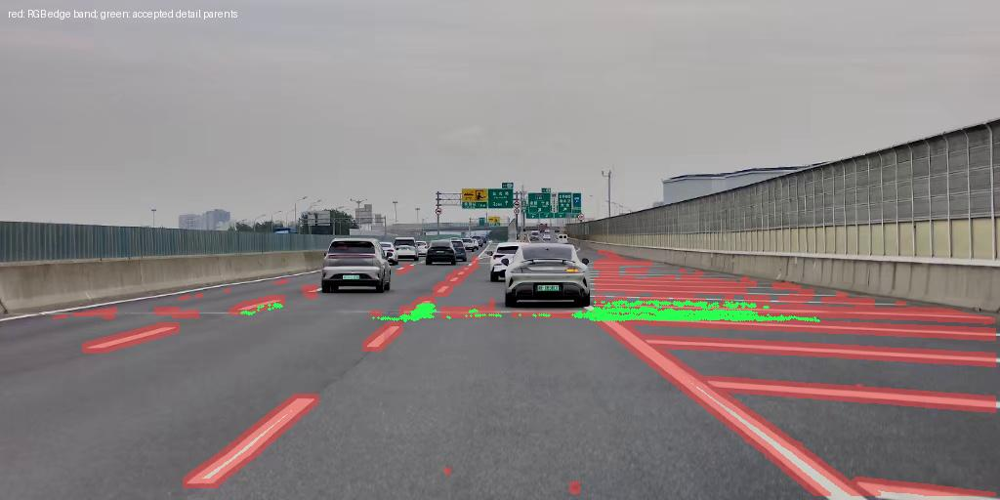

# 多视角高频引导的路面初始化

## 实现目标和边界

保留原约 5 cm 的 RoadNodes 网格，只在真实训练图像反复支持的路面颜色边缘附近，预先补充约 2.5 cm 间距的小高斯。无需标线几何标签，也不启用训练时的动态致密化。

这是高频区域的空间采样分配，不是直接估计标线的正确轮廓。新增高斯初始为小的平面足迹，训练中独立优化 XY 尺度、颜色和 opacity；中心、旋转、厚度继续沿用训练器的冻结规则。

## 具体流程

1. 原路面点云重采样流程保持原样，生成底层中心、颜色和高度。
2. 在当前训练组的真实 RGB 中提取 3px/7px 两尺度颜色梯度。梯度计算前的有效区域排除 road mask 外、ego、sky、dynamic/human/vehicle，向内腐蚀 4px；边缘带膨胀 3px，覆盖边缘两侧。
3. 将现有曲面采样点投影到图像，按有效可见次数累计边缘支持率。采用 road 自遮挡近似深度缓冲，并利用可用的稀疏 LiDAR 深度排除遮挡；非有限或非正 LiDAR 深度按未知值处理。
4. 默认每 10 个训练时刻取一帧，加入最后一个训练时刻，最多 60 个相机/时刻观测。时间采样只使用 `dataset.train_timesteps`；每相机相邻入选观测位置至少相差 0.5m。不同相机可共同提供支持，不强制必须有几个不同相机。
5. 至少 3 个有效观测支持、支持率至少 0.35 的底层位置才成为加密候选。以支持率和平均梯度强度排序，预算为底层点数的 25%。
6. 在完整 5cm 网格单元内插入边中点和中心，共最多三个半间距候选。要求四个角都有底层支撑，角点高度差不超过 5cm；高度由局部角点插值，不使用整个场景的统一高度平面。
7. 新候选再次通过多视角可见性与边缘支持检查后才保留；最终按分数裁到硬预算。预算意味着并非每个单元必定补齐全部三个点，也不会为凑数量补无证据区域。
8. 新点颜色使用最多 7 个有效可见观测逐通道中位数初始化，XY 标准差为 1.5cm、opacity 为 0.1。原底层实际初始值保持 4cm、0.7。
9. 前 1000 步按点逐步开放新增点的颜色/尺度/opacity 优化。未开放点梯度为零，底层不受此限制；没有用简单的梯度乘小系数冒充 Adam 下的学习率 warmup。所有新点从初始化开始就以低 opacity 参与渲染。

为了复用现有可靠曲面，具体实现采用“在曲面生成候选并投影验证”，而非逐像素射线寻找交点；两者目标相同，前者不需要额外构建可相交 mesh。

## 训练入口与开关

已接入 `MultiTrainer.init_gaussians_from_dataset` → `RoadNodes.create_from_pcd`，配置为：

```yaml
model:
  RoadNodes:
    init:
      high_frequency:
        enabled: true
        max_extra_ratio: 0.25
        detail_scale: 0.015
        detail_opacity: 0.1
        detail_warmup_steps: 1000
```

完整阈值见 `configs/omnire_extended_cam_lidar.yaml`。现有普通 3D RoadNodes、平滑尺度参数化和关闭 road edge split 是启用前提。

运行方式仍为本 worktree 根目录：

```bash
bash scripts/qcraft/group_training.sh 20260613_102138_QCJPTDJ07384_3298_3308
```

默认只训练/评估 group0，新轨迹默认只读取 group0。实验标识改为 `road-hf-init`，避免与 `road-adaptive-s-o` 结果混淆。GPU 仍由当前 `common.sh` 的设置或 `GROUP0_GPU` 控制。

该机制只在从头初始化时执行。恢复旧 checkpoint 保留旧点，不会自动追加 HF 点，并输出提醒；恢复已有 HF checkpoint 时保留新增点标记，不重复补点。新增 `_hf_detail_mask` buffer 记录细节点身份，旧 checkpoint 缺失该字段时自动补全为 False。

禁用时设置 `model.RoadNodes.init.high_frequency.enabled=false`。原有颜色、边缘、覆盖率和贡献损失权重未修改。保留底层网格指保持其初始化采样，不是额外强制底层点始终高 opacity；原覆盖约束仍作用于联合 RoadNodes。

## 检查输出

从头训练时自动写入 `<run_dir>/group0/road_init/`：

- `summary.json`：底层数、观测数、候选数、最终增加数和预算。
- `details.npz`：新增点坐标/颜色、父点索引及候选分数。
- `edge_evidence_bev.png`：空间边缘证据。
- `detail_density_bev.png`：灰色底层点，橙色新增点。
- `camera_*_frame_*.jpg`：红色为图像边缘带，绿色为实际产生新增点的父点投影。绿色不是新增点本身。

没有足够证据时保留底层并明确告警，不改用随机或全局加密。

## 已完成验证

- 32 项 CPU unittest 和原有 3 项路面先验检查通过。
- 真实 RoadNodes 初始化测试确认底层中心、尺度和 opacity 不变，新增点数量、1.5cm 尺度、0.1 opacity 正确。
- 检查平坦区域不加密、单视角/静止重复视角不足以构成时序共识、测试时刻排除、动态/深度遮挡、局部斜坡插值、缺角/台阶拒绝，以及多视角中位数颜色融合。
- 检查新增点的优化开放在 Adam 下有效，checkpoint 恢复后身份/实际属性保持，不触发训练时补点。
- 已完成真实场景 CPU 局部预览，见 [预览说明](road_hf_preview/context.json) 和 [统计](road_hf_preview/summary.json)：使用旧 checkpoint 的固定底层中心，在第 30/40/50 帧、group0 五相机共15个观测中，65,536 个底层点新增 13,540 个点（20.66%）。预览只验证证据定位与局部补点，没有使用训练后的颜色初始化，也没有模拟完整从头点云处理。



预览文件中的局部帧索引 0/1/2 对应真实第30/40/50帧；图中绿色仅显示预览空间裁剪内的父点，不能把其余位置没有绿色解释为整场景初始化漏检。

尚未执行完整 CUDA 初始化/反向、完整场景峰值显存测量或新训练画质验证。多视角重复的阴影或路面纹理仍可能入选；固定阈值、小标定偏差、近场投影采样间隔和现有曲面误差可能造成漏选或误选。投影深度缓冲和 mask 是可见性近似，不是精确场景光线追踪。
